<h2>Hi, I'm Rea Amparo 👋</h2>

<strong>BS Computer Science Student · Software & Mobile Development · Applied Computer Vision</strong>

  I build practical applications, explore machine learning, and turn ideas into working software.
   
  Currently learning, building, and improving one project at a time.

  
  

---

## About

I'm a **BS Computer Science student** interested in building useful software and understanding how technology works from the inside out. My main areas of interest are **mobile application development, web development, and applied machine learning**.

I enjoy working across the development process—from shaping an interface and writing application logic to connecting backend services and testing how everything works together.

### Current focus

- **Mobile development** — building Flutter applications and connecting them to backend services.
- **Computer vision** — exploring CNN-based image classification, model evaluation, and mobile deployment.
- **Web development** — creating responsive interfaces and learning better ways to build and ship web projects.

---

## Featured Projects

<table>
  <tr>
    <td width="50%" valign="top">
      <h3>01 · Cacao Vision</h3>
      
<strong>Black Pod Rot Severity Classification</strong>

      
An ongoing thesis research project focused on classifying visible Black Pod Rot severity in cacao pods into Low, Moderate, and Severe. The study evaluates a baseline CNN against a Bayesian hyperparameter-optimized CNN.

      
Python · CNN · Bayesian Optimization · Computer Vision · Flutter

      
<strong>Status:</strong> Thesis research in progress · Source repository is private

    </td>
    <td width="50%" valign="top">
      <h3>02 · TRACE</h3>
      
<strong>SSG Attendance System</strong>

      
A Flutter application prototype for managing school event attendance, with QR-based check-in, role-based access, and location-based validation.

      
Flutter · Dart · Firebase · Cloud Firestore

      
<strong>Status:</strong> Project prototype · Source repository is private

    </td>
  </tr>
  <tr>
    <td width="50%" valign="top">
      <h3>03 · Gender-Neutral Language Recognizer</h3>
      
A Flask web application prototype that identifies configured gender-specific wording and suggests gender-neutral alternatives.

      
Python · Flask · HTML · CSS · JavaScript

      
<strong>Status:</strong> Prototype · Repository is currently private

    </td>
    <td width="50%" valign="top">
      <h3>04 · Personal Portfolio</h3>
      
A personal website for presenting selected projects, technical interests, and development work, built with standard web technologies.

      
HTML · CSS · JavaScript

      
<a href="https://github.com/msreaamparo-wq/Portfolio"><strong>View public repository →</strong></a>

    </td>
  </tr>
</table>

---

## Tech Stack

*Tools and technologies I use or explore through coursework, personal projects, and research.*

### Languages

  

**Also:** SQL

### Frameworks & Platforms

  

**Mobile:** Flutter, Provider, TensorFlow Lite integration  
**Web:** Flask, React, Node.js, FastAPI, Bootstrap, Tailwind CSS

### Machine Learning & Data

  

**Also exploring:** torchvision, Pillow, CNNs, Bayesian hyperparameter optimization, Roboflow, and YOLO.

### Developer Tools

  

**Also used:** Google Colab, Android SDK, Flutter SDK, Firebase Console, and PowerShell.

---

## GitHub Activity

 

### Contribution Trail

A contribution-history animation generated automatically with GitHub Actions.

<picture>
  <source media="(prefers-color-scheme: dark)" srcset="https://raw.githubusercontent.com/msreaamparo-wq/msreaamparo-wq/output/pacman-contribution-graph-dark.svg"/>
  <source media="(prefers-color-scheme: light)" srcset="https://raw.githubusercontent.com/msreaamparo-wq/msreaamparo-wq/output/pacman-contribution-graph.svg"/>
  
</picture>

---

**Build with purpose. Learn continuously. Make things that work.**

<a href="https://github.com/msreaamparo-wq?tab=repositories">Browse repositories</a>
&nbsp;·&nbsp;
<a href="https://github.com/msreaamparo-wq/Portfolio">Portfolio source</a>

