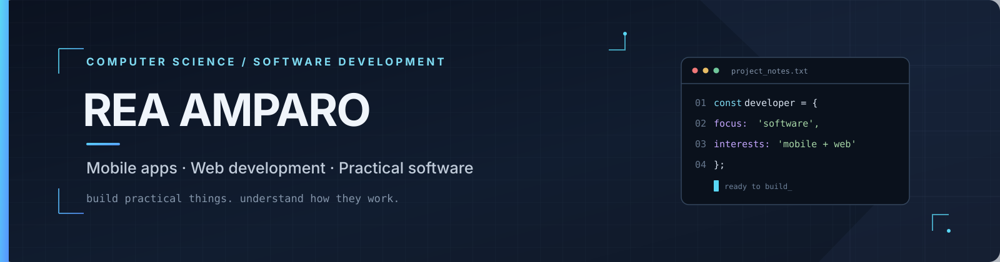
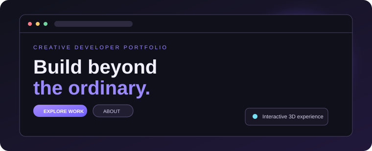
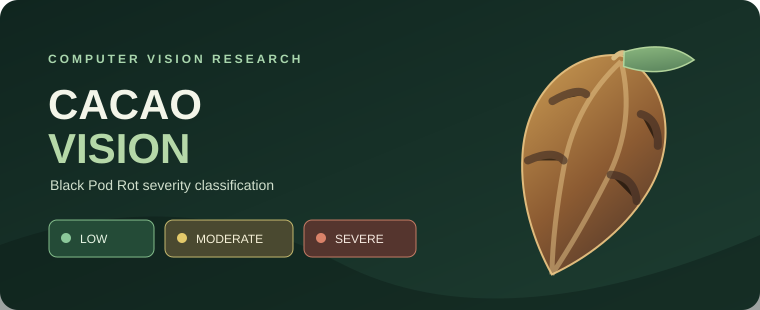
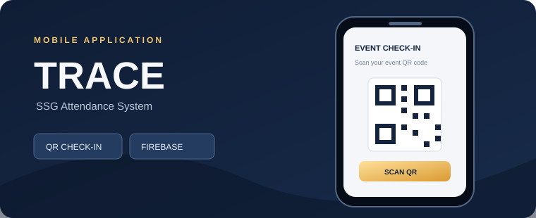
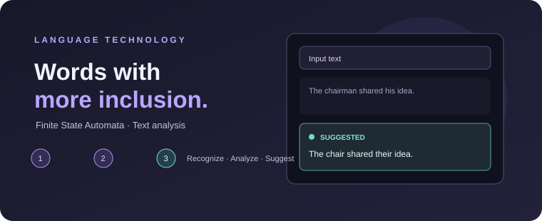

<h1>Rea Jamila Amparo</h1>

<strong>Computer Science Student&nbsp; · &nbsp;Software Developer</strong>

Building mobile apps, web experiences, and practical software.

---

## Selected work

<table>
  <tr>
    <td width="50%" valign="top">
      
      <h3>Interactive Developer Portfolio</h3>
      Three.js · JavaScript · HTML · CSS
      
A cinematic portfolio with an interactive 3D experience.

      <a href="https://msreaamparo-wq.github.io/">Live preview ↗</a>
      &nbsp;·&nbsp;
      <a href="https://github.com/msreaamparo-wq/Portfolio">Source ↗</a>
    </td>
    <td width="50%" valign="top">
      
      <h3>Cacao Vision</h3>
      Python · CNN · Bayesian Optimization · Flutter
      
Thesis research for classifying cacao Black Pod Rot severity: Low, Moderate, and Severe.

      Research in progress
    </td>
  </tr>
  <tr>
    <td width="50%" valign="top">
      
      <h3>TRACE — SSG Attendance</h3>
      Flutter · Dart · Firebase
      
A mobile attendance prototype with QR event check-in and role-based access.

      Application prototype
    </td>
    <td width="50%" valign="top">
      
      <h3>Gender-Neutral Language Recognizer</h3>
      Python · Flask · Finite State Automata
      
An academic tool that detects gender-specific wording and suggests neutral alternatives.

      Academic project
    </td>
  </tr>
</table>

---

## Tech stack

**LANGUAGES**

**FRAMEWORKS & PLATFORMS**

**TOOLS**

Also exploring: PyTorch · TensorFlow Lite · scikit-learn · Roboflow · CNNs · Bayesian hyperparameter optimization

---

## GitHub overview

---

**Learn continuously. Build thoughtfully.**

<a href="https://msreaamparo-wq.github.io/">Portfolio</a>
&nbsp;·&nbsp;
<a href="https://github.com/msreaamparo-wq?tab=repositories">Repositories</a>

