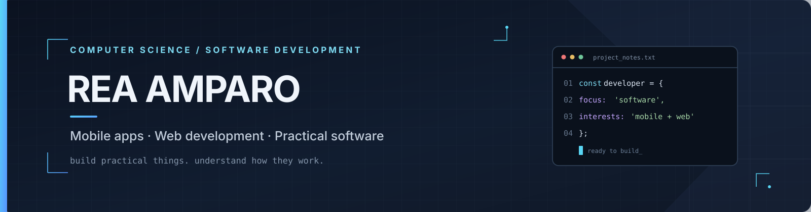
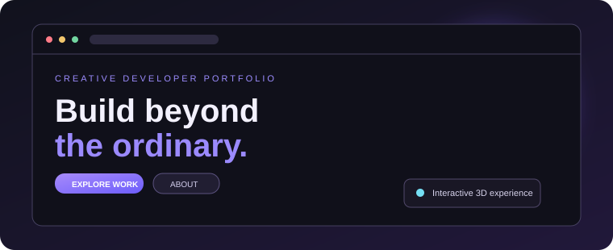
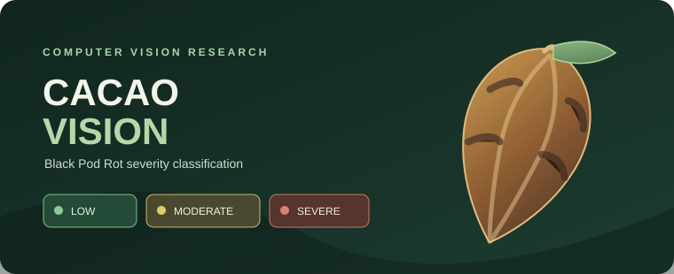
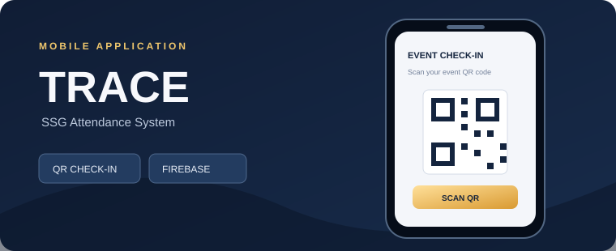
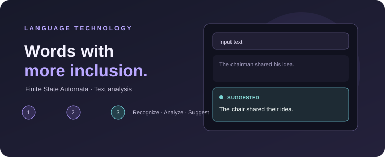

<h1>Rea Jamila Amparo</h1>

<strong>Computer Science Student&nbsp; · &nbsp;Software Developer</strong>

Building mobile apps, web experiences, and practical software.

---

## Selected work

<table>
  <tr>
    <td width="50%" valign="top">
      
      <h3>Interactive Developer Portfolio</h3>
      Three.js · JavaScript · HTML · CSS
      
A cinematic portfolio with an interactive 3D experience.

      <a href="https://msreaamparo-wq.github.io/">Live preview ↗</a>
      &nbsp;·&nbsp;
      <a href="https://github.com/msreaamparo-wq/Portfolio">Source ↗</a>
    </td>
    <td width="50%" valign="top">
      
      <h3>Cacao Vision</h3>
      Python · CNN · Bayesian Optimization · Flutter
      
Thesis research for classifying cacao Black Pod Rot severity: Low, Moderate, and Severe.

      Research in progress
    </td>
  </tr>
  <tr>
    <td width="50%" valign="top">
      
      <h3>TRACE — SSG Attendance</h3>
      Flutter · Dart · Firebase
      
A mobile attendance prototype with QR event check-in and role-based access.

      Application prototype
    </td>
    <td width="50%" valign="top">
      
      <h3>Gender-Neutral Language Recognizer</h3>
      Python · Flask · Finite State Automata
      
An academic tool that detects gender-specific wording and suggests neutral alternatives.

      Academic project
    </td>
  </tr>
</table>

---

## Developer milestones

Ten milestones from my software projects and research. These are personal project milestones, not official GitHub-earned achievement badges.

<table>
  <tr>
    <td width="50%" valign="top">
      
      
<strong>Flutter App Builder</strong> Developed mobile application prototypes using Flutter and Dart.

    </td>
    <td width="50%" valign="top">
      
      
<strong>QR Attendance Workflow</strong> Built TRACE attendance flows for campus events, QR check-in, and location verification.

    </td>
  </tr>
  <tr>
    <td width="50%" valign="top">
      
      
<strong>Firebase Integration</strong> Worked with Firebase Authentication, Cloud Firestore, and Firebase Storage in TRACE.

    </td>
    <td width="50%" valign="top">
      
      
<strong>Full-Stack Platform Builder</strong> Developed CauseVia, a fundraising platform with campaign, donor, and organizer workflows.

    </td>
  </tr>
  <tr>
    <td width="50%" valign="top">
      
      
<strong>Computer Vision Research</strong> Working on cacao Black Pod Rot severity classification using pod images.

    </td>
    <td width="50%" valign="top">
      
      
<strong>Bayesian HPO Research</strong> Exploring Bayesian optimization to tune CNN training hyperparameters for the cacao study.

    </td>
  </tr>
  <tr>
    <td width="50%" valign="top">
      
      
<strong>FSA-Based Language Tool</strong> Created a recognizer for configured gender-specific terms and neutral alternatives.

    </td>
    <td width="50%" valign="top">
      
      
<strong>Flask Web Application</strong> Built a web interface and document-analysis workflow for the language recognizer.

    </td>
  </tr>
  <tr>
    <td width="50%" valign="top">
      
      
<strong>Interactive 3D Web Experience</strong> Created a cinematic developer portfolio using Three.js, JavaScript, HTML, and CSS.

    </td>
    <td width="50%" valign="top">
      
      
<strong>GitHub Pages Deployment</strong> Published a developer portfolio and shared web projects through GitHub Pages.

    </td>
  </tr>
</table>

---

## Tech stack

**LANGUAGES**

**FRAMEWORKS & PLATFORMS**

**TOOLS**

Also exploring: PyTorch · TensorFlow Lite · scikit-learn · Roboflow · CNNs · Bayesian hyperparameter optimization

---

## GitHub overview

### Pac-Man contribution graph

<picture>
  <source media="(prefers-color-scheme: dark)" srcset="https://raw.githubusercontent.com/msreaamparo-wq/msreaamparo-wq/output/pacman-contribution-graph-dark.svg"/>
  <source media="(prefers-color-scheme: light)" srcset="https://raw.githubusercontent.com/msreaamparo-wq/msreaamparo-wq/output/pacman-contribution-graph.svg"/>
  
</picture>

---

**Learn continuously. Build thoughtfully.**

<a href="https://msreaamparo-wq.github.io/">Portfolio</a>
&nbsp;·&nbsp;
<a href="https://github.com/msreaamparo-wq?tab=repositories">Repositories</a>

